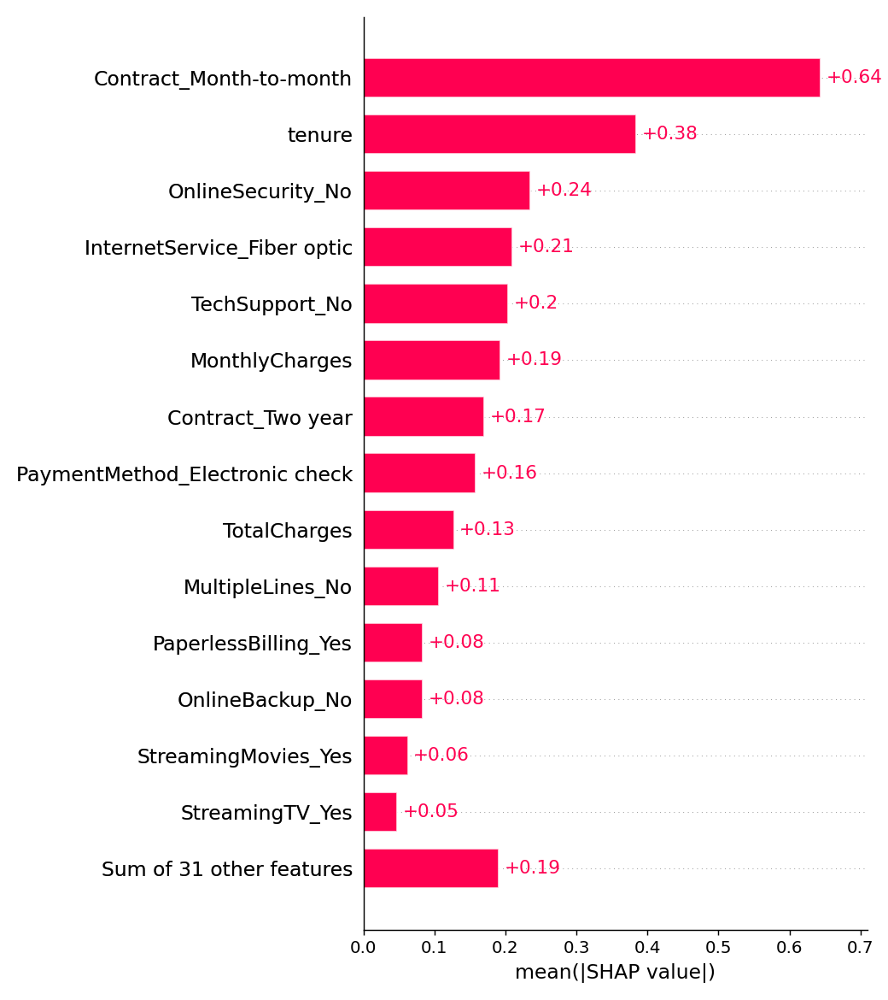

# Customer Churn Prediction with SHAP & Streamlit

Predict which telecom customers are likely to leave, and **explain why** with SHAP. Includes a Streamlit app where you can change a customer's profile and see the churn risk and its drivers update live.

## Highlights
- **Data:** IBM Telco Customer Churn (7,043 customers, ~27% churn). Downloaded automatically; a synthetic fallback with the same schema is used if the download fails.
- **Models:** Logistic Regression (baseline) vs Gradient Boosting (explained with SHAP `TreeExplainer`).
- **Explainability:** global importance + beeswarm plots, and a per-customer waterfall in the app.
- **App:** probability, risk level (Low / Medium / High) and the top factors raising or lowering the risk.

## Results (20% stratified test set)

| Model | ROC-AUC | Accuracy | Precision | Recall | F1 |
|---|---|---|---|---|---|
| Logistic Regression (balanced) | 0.841 | 0.740 | 0.506 | 0.786 | 0.616 |
| Gradient Boosting | 0.844 | 0.805 | 0.669 | 0.524 | 0.588 |

Logistic Regression catches more churners (higher recall); Gradient Boosting makes fewer false alarms (higher precision). Both rank customers equally well (ROC-AUC).

Top drivers (SHAP): month-to-month contract, short tenure, no online security, fiber optic, no tech support, high monthly charges.



## Run it

```bash
git clone https://github.com/<your-user>/churn-prediction-shap.git
cd churn-prediction-shap
python -m venv .venv && source .venv/bin/activate   # Windows Git Bash: source .venv/Scripts/activate
pip install -r requirements.txt
python -m src.train          # downloads data, trains, saves model + SHAP plots
streamlit run app/app.py
pytest -q
```

## Structure
```
src/   config.py · data.py · train.py · explain.py
app/   app.py            (Streamlit)
tests/ test_pipeline.py
reports/  metrics.json · shap_*.png
```

## Possible extensions
Hyper-parameter tuning, probability calibration, threshold optimisation for a retention-campaign budget, XGBoost/LightGBM, model monitoring.
